# GUI, Bewegung und fahrzeuggebundener Bau – 1.0.18

Stand: 25. November 2026. Diese Lieferung erweitert P04/P05, P06/P07, P08, P11 und P19–P22. Maßgeblich sind D-038 bis D-044, T-059 bis T-069, GUI-015 bis GUI-021, SURFACE-010, SPACE-012, LOG-014, ARCH-017 und TEST-034 bis TEST-039. Der frühere GUI-/Bau-Stand bestand 177 Core-Tests, Windows-Build und die unten getrennten Render-/Controllerläufe.

Danach kamen direkte Rechtsklickbefehle, kollisionsfreie Bewegung mit Platzmachen, nahtfreie Planetentexturen und persistenter Planetenfokus hinzu. Der isolierte Interaktionslauf `20261125-214652` bei 1280×720 bestand **106 Einzelbedingungen plus Gesamt-PASS** und erzeugte **17 PNGs**. Er prüfte direkte Befehle und rote Cursorpixel, sanften Anflug, fortlaufenden Fokus auf bewegte Planeten, Kamerafreigabe und sechs tatsächlich gerenderte Meridianübergänge. Alle neun Schiffsmodelle passen einschließlich Turmdrehung in ihre Core-Radien; gemeinsame Zwischenbilder echter Gegenverkehrticks bleiben getrennt. Dieser Lauf ersetzt nicht die noch laufende vollständige Wirtschafts-/Verkehrsabnahme. Version 1.0.18 bleibt bis zu Abschlussprüfung, Installerlauf und Git-Integration in Arbeit.

## Auftrag und Referenzgrenzen

Die GUI soll der im Chat entworfenen [Konzepttafel](GUI_REFERENCE.png) eng folgen. Alle drei Richtungen bleiben auswählbar. Der Nutzer verlangt größere, separat verstellbare Schrift, übersichtlichere Menüs, flüssigere Bewegung, gerundete Straßen, eigenständig ausgerichtete Türme, Schuss-/Treffereffekte, ausführlichere Modelle, größere natürliche Oberflächen und eine echte, längere Konstruktion durch Baufahrzeuge.

Die Raster-Konzepttafel gibt Farben, Anordnung und Hierarchie vor; räumliche Modelle und ihre Rückseiten müssen daraus gestaltet werden. Ein pixelgenauer 1:1-Abnahmebeleg gegen diese Tafel liegt bisher nicht vor. Verwendet werden eigene Modelle und Materialien.

## Recherche vor der Umsetzung

Beobachtbare Quellenangaben und daraus abgeleitete Entscheidungen sind getrennt:

| Quelle und belegter Befund | Ableitung für PlanetOne |
|---|---|
| [C&C Remastered: Sidebar, EA-Produzent Jim Vessella](https://www.reddit.com/r/commandandconquer/comments/bx59ym/remaster_update_and_first_sidebar_preview/) beschreibt getrennte Register für Gebäude, Infanterie, Fahrzeuge und Unterstützung sowie weniger Scrollen. | Aufgaben nach Zweck gruppieren; häufige Aktionen sofort anbieten, Spezialverwaltung gezielt öffnen. |
| [C&C Remastered: Missionsauswahl, Entwicklerbeitrag](https://www.reddit.com/r/commandandconquer/comments/ct1oz8/) beschreibt Missionsstatus und Details zur gewählten Mission in einem gemeinsamen Auswahlbereich. | Szenario- und Speicherplatzauswahl erhalten eine erkennbare Auswahl mit eigener Detailkarte; Navigation bleibt sichtbar. |
| [Haegemonia: offizielles Handbuch](https://shared.fastly.steamstatic.com/store_item_assets/steam/apps/294770/manuals/haegemonia_manual.pdf?t=1569579915), Abschnitte 8.1.3.3–8.2 und 13.4, trennt globale Menübereiche von Planeten-/Squadinformationen und kontextbezogenen Aktionen. | Globale Navigation, Objektidentität und Objektbefehle unterscheiden; Auswahl im Bild und in der Liste führen zu denselben gültigen Aktionen. |
| [Solar 2: Entwickler-Ankündigung zu 1.23](https://store.steampowered.com/oldnews/?appgroupname=Solar+2&appids=97000&feed=steam_community_announcements&l=romanian), 31. August 2021, nennt Interface-Skalierung und einen eigenen Missionsbildschirm. | Auch ein zurückhaltendes Weltraumlayout braucht anpassbare Lesbarkeit und eigene, klar gegliederte Auswahlseiten. Eine separate Schriftoption wird hier durch den Nutzerauftrag begründet. |
| [Game Accessibility Guidelines: Font size](https://gameaccessibilityguidelines.com/allow-the-font-size-to-be-adjusted/) empfiehlt einstellbare Schriftgrößen statt einer einzigen Größe für alle Spieler. | Schrift separat einstellbar, direkt sichtbar und lokal gespeichert. |
| [Microsoft XAG 101: Text display](https://learn.microsoft.com/en-us/gaming/accessibility/xbox-accessibility-guidelines/101) behandelt Mindesttextgröße und Skalierung ohne Funktionsverlust. | GUI-Skalierung darf Schrift bei kleinerem Fenster nicht unbeabsichtigt verkleinern; flexible Zeilenhöhen und Scrollbereiche. Unity-`fontSize` ist nicht gleich gemessene Glyphenhöhe. |

Ergänzende C&C-Videoquellen wurden anhand offizieller Einträge und Verlinkungen verifiziert: [EA First Gameplay Teaser, 25. Oktober 2019](https://www.youtube.com/watch?v=1uPOr8PxeXk), [EA Official Reveal Trailer, 10. März 2020](https://www.youtube.com/watch?v=9iMfypQj3k0), [offizielle EA-Launchseite](https://www.ea.com/ea-play/news/official-launch-trailer) mit [eingebettetem Launch-Trailer](https://www.youtube.com/watch?v=DrtodXOIeW8) sowie der [Entwicklerbeitrag zum Gameplay-Teaser](https://www.reddit.com/r/commandandconquer/comments/dm28fw/remaster_update_and_first_gameplay_teaser/). Der Abruf abspielbarer YouTube-Inhalte gelang nicht. Es wurden **keine Videoframes ausgewertet**; weder framegenaue Analyse noch 1:1-Nachbildung einer Filmsequenz werden behauptet.

## Recherche zu dynamischem Verkehr

| Primärquelle und beobachtbarer Befund | Ableitung für PlanetOne |
|---|---|
| [ORCA-Autorenseite](https://gamma-web.iacs.umd.edu/ORCA/) beschreibt lokale, paarweise aufgeteilte Ausweichverantwortung und Geschwindigkeitswahl; das [Originalpaper](https://gamma.cs.unc.edu/ORCA/publications/ORCA.pdf), Abschnitte 5.2–5.4, behandelt Deadlocks, dichte Belegung und die Grenze zum globalen Wegplaner. | Globale Route, lokale Kollisionsprüfung und das Öffnen einer blockierten Formation separat behandeln; lokale Abstoßung allein verspricht keinen Durchbruch. |
| [RVO2-Parameterdokumentation der Autoren](https://gamma-web.iacs.umd.edu/RVO2/documentation/2.0/params.html) definiert Körperradius, Zeithorizont und Nachbarbetrachtung. Zu kleine Nachbardistanz oder Nachbaranzahl gefährdet sichere Bewegung. | Reale Körperabstände berücksichtigen und vollständige relevante Tickstrecken prüfen, nicht nur freie Endpunkte. |
| [Dergachev/Yakovlev, CASE 2021](https://arxiv.org/abs/2107.00246) beschreibt Deadlocks reaktiver Vermeidung in engen Räumen und lokal koordinierte Wegplanung für betroffene Gruppen. | Eigene Blockierer zeitweise koordinieren und gegebenenfalls eine Ausweichkette öffnen, dabei ursprüngliche Aufträge behalten. |
| [Unity NavMeshAgent.avoidancePriority](https://docs.unity.com/en-us/engine/6000.0/script-reference/unityengine/ai/navmeshagent/avoidancepriority) beschreibt Prioritäten und das Ignorieren niedriger priorisierter Agenten bei der Vermeidung. | Priorität darf in PlanetOne nur das Platzmachen entscheiden; sie hebt die harte Körperprüfung nicht auf. |

Diese Quellen begründen die Trennung der Aufgaben. Implementiert wird die begrenzte, deterministische eigene Core-Logik; **keine ORCA-/RVO2- oder NavMesh-Bibliothek wurde eingeführt**. Eine vollständig geschlossene Blockade ohne legale freie Position bleibt ehrlich blockiert. Eine allgemeine Lösung sämtlicher Mehragenten-Wegeprobleme wird nicht behauptet.

## Implementierte Bedienung und Darstellung

- **Direkte Befehle:** Kurzer Rechtsklick bewegt die Auswahl oder greift einen sichtbaren Kriegsgegner an; Strg + Rechtsklick öffnet ausschließlich das Kontextmenü. Rechtsziehen verschiebt die Kamera ohne losgelösten Bewegungsbefehl. Modellbasierte Auswahlrahmen und rotes Angriffsfadenkreuz kennzeichnen Akteur und zulässiges Ziel. Neutrale/verdeckte Einheiten lösen keinen automatischen Angriff oder Krieg aus. Controller- und Pixelprüfungen bestanden im isolierten Player.
- **Planetenfokus und Textur:** „Planet zentrieren“ fährt in 0,9 Sekunden zum Planeten und folgt danach dessen Keplerposition. Pan, Drehung, Zoom und Pos1 lösen die Verfolgung. Die Seitenliste führt zum gewählten Planeten im System; aus einer Oberfläche kommt zuerst der bestehende animierte Rückflug. Zwei überlappende Winkelabtastungen mit korrigierten Texturableitungen beseitigen die Meridian-/Mip-Kante der unveränderten Atlanten. Die sechs Shaderproben bestanden mit erhaltener Texturzeichnung; die mittlere RGB-Differenz benachbarter Pixel an der alten Schnittkante lag zwischen 0,0058 und 0,0526.

- **Drei Layouts:** Kommandozentrale mit ausgeprägter Verwaltung, Orbitale Brücke mit Navigation und Befehlsdeck, Freier Weltraum mit schwebenden Bedienelementen. Dieselben Aktionen bleiben verfügbar. Karten, Symbole und Flächen verwenden eine gemeinsame Gestaltung. Abgerundete Rahmen und ihre Farbbänder folgen in allen Zuständen derselben SDF-Kontur.
- **Schrift:** Einstellungen → Schrift und Größe trennt Textgröße und Oberflächengröße. Text ist zwischen 90 und 140 Prozent einstellbar; Schnellwerte sind 100, 115, 130 und 140 Prozent. Nominale Basiswerte sind 18 Bildschirm-Pixel für Fließtext, 17 für Schaltflächen und 15 für sekundäre Beschriftungen. Fenster- und GUI-Skalierung werden berücksichtigt.
- **Menüs:** Start/Pause, Neue Partie, Speichern/Laden und Starthilfe erhalten permanente Navigation und getrennte Inhaltskarten. Speicherplätze zeigen Zustand und Details zur Auswahl; Bestätigungen benennen die konkrete Aktion. Militär, Invasion, Flotte, Forschung, Versorgung und Diplomatie sind in Aufgabenbereiche gegliedert. Kontextmenüs und bestehende gemeinsame Befehlsvalidierung bleiben erhalten.
- **Kolonien:** Neue reguläre Oberflächen haben 40 × 32 Waben. Karten aus vorhandenen Zuständen und ausdrücklich dimensionierte Fixtures werden nicht nachträglich gestreckt. Wälder bilden unregelmäßige, aus dem System-Seed reproduzierbare Flecken statt diagonaler Bänder. Typabhängige Pflanzen, Gelände-Materialien und ausführlichere Gebäudegeometrie ergänzen das Relief. Berechnete Geländehöhen werden zwischengespeichert. Eine transparente Modellvorschau markiert gültige und ungültige Bauplätze.
- **Bauphasen:** Angeliefertes Material, Fundament, Tragwerk/Leitungen und Verkleidung/Montage werden aus tatsächlichem Bestand und Baufortschritt dargestellt. Montagegerüst und Arbeitsanzeige ersetzen keinen Simulationsfortschritt; bei Stillstand darf kein laufender Bau vorgetäuscht werden.
- **Bewegung und Straßen:** Positionen und Ausrichtung bewegter Modelle werden geglättet. Straßenränder und physisch geprüfte Kurierpositionen verwenden gemeinsame quadratische Kurven, einschließlich Anschlüssen an Gebäude. Hexpfad und Core-Fortschritt bleiben autoritativ. Die neue Körper-/Ausweichlogik ist unten getrennt beschrieben; zusätzliche Fahrspuren oder ein Kantengraph werden nicht eingeführt.
- **Kampf:** Der Core meldet reale Schüsse und Zerstörungen in einem begrenzten, sichtgefilterten Ereignisstrom. Runtime erzeugt Mündungsbilder, Geschosse, Treffer und Explosionen und richtet Türme unabhängig vom Fahrzeug aus. Effekte berechnen keinen zweiten Schaden; verdeckte Treffer werden nicht offengelegt. Vergangene Effekte werden nicht im Spielstand gespeichert.
- **Systemansicht:** Orbitlinien werden beim Zoom auf nominal 1,25 Bildschirm-Pixel umgerechnet. Asteroiden erhalten eine zusätzliche Sichtskalierung um Faktor 1,8 gegenüber 1.0.17, mit Modellskalendeckel 0,11. Die frühere Viertel-Mond-Grenze wird durch T-060 ersetzt; Vorkommen und Bahnregeln bleiben unverändert.
- **Kamerafahrt:** Zwischen System und Oberfläche laufen 1,8 Sekunden Animation zuzüglich kurzer, variabler Oberflächenvorbereitung. Unter der Atmosphärenblende verteilt sich der Aufbau auf mehrere Frames; die gesamte Übergangszeit ist daher nicht fest 1,8 Sekunden. Die Rückfahrt stellt den vorherigen Systemausschnitt wieder her. Die Fahrt ist ein Darstellungswechsel derselben Simulation und erhält den bestehenden Pausenzustand.

## Physischer Boden- und Raumverkehr

Typabhängige Radien und die Prüfung vollständiger Tickstrecken verhindern, dass Einheiten sich überlagern oder in einem Schritt durcheinander fahren. Die Bodenprüfung umfasst Truppen, aktive Kuriere und Baufahrzeuge; angedockte Warenfahrzeuge stehen intern am Übergabepunkt. Eigene Blockierer dürfen zeitweise auf legale freie Positionen ausweichen, gegebenenfalls als lokale Kette. Gegner oder fremde Verbündete erhalten keine solchen Aufträge. Ursprünglicher Befehl, ID und Ladung bleiben erhalten; ein ausweichender Bauarbeiter erzielt keinen Baufortschritt.

Raumschiffe erhalten getrennte Ankunftsplätze; nachträglich belegte Plätze werden nach anhaltender Blockierung neu gesucht. Echte Hafenübertragung und KI verwenden dieselbe Docksemantik. Spawn, bezahlter Schiffsbau, Aufstieg, Rekrutierung und Entladung warten bei belegten Ausgängen, statt Bestand oder Besatzung zu duplizieren. Tatsächlich unlösbare Engstellen bleiben blockiert. Speichern/Laden erhält Ausweichziele, Fortschritt, Wartezeiten und Ankunftsreservierungen. Gezielte Core-Tests sind bestanden; vollständige Integration und Renderabnahme stehen aus.

## Tatsächliche Konstruktion und Speicherung

Die vorhandenen vier Kurierkapazitäten werden gemeinsam für Waren und Bau verwendet. Höchstens zwei gleichzeitig laufende Baueinsätze binden Fahrzeuge, **einschließlich An- und Rückfahrt**. Fehlendes Baumaterial reserviert noch kein Baufahrzeug; mindestens zwei Kapazitätsplätze bleiben für Logistik frei. Nach vollständiger Materialanlieferung fährt ein freies Fahrzeug vom Kommandozentrum zur Baustelle. Auf Gaswelten übernimmt dies eine vorhandene Frachtdrohne.

Erst nach Ankunft werden die Baukosten einmalig verbraucht. `BuildProgress` wächst nur mit vorhandenem Fahrzeug vor Ort und gültigem Anschluss; Nahrungsmangel reduziert weiterhin die Produktivität. Reine Gebäude-Arbeitszeiten sind gegenüber 1.0.17 verdoppelt: etwa Solaranlage 6 Sekunden, Lager 8 Sekunden, Fahrzeugwerk 16 Sekunden und Sprungtorgebäude 60 Sekunden, jeweils zuzüglich Lieferung und Anfahrt. Komponentenlieferung und Aktivierung des Sprungtors sind separate bestehende Abläufe.

Nach Fertigstellung fährt dasselbe Fahrzeug zurück. Ein Straßenabriss stoppt es an seiner tatsächlichen Position oder erlaubt einen vorhandenen Umweg; sein Kapazitätsplatz wird erst nach Rückkehr frei. Abbruch vor Arbeitsbeginn erhält unverbrauchtes Material vollständig. Nach Arbeitsbeginn gilt die bestehende abgerundete 50-Prozent-Rückgewinnung; militärische Zerstörung erstattet keine Gebäudekosten. Zurückgewonnenes Material wird weiterhin physisch abgeholt. Besitzerwechsel ruft den zugeordneten Bauarbeiter zurück.

Das aktuelle Schema ist **13**. Der vorherige Schema-12-Schritt ergänzte am bestehenden `ShipmentState` die Phasen `BuilderOutbound`, `Building` und `BuilderReturning`; Schema 13 ergänzt die zustandsführenden Boden-/Raumverkehrsdaten. Kennung, Quell-/Zielgebäude, Hexpfad und Wegfortschritt bleiben gespeichert. Baueinsätze tragen `Amount = 0`; die Savevalidierung verhindert Phantomladung, doppelte aktive Besetzung und Überschreiten der Kapazität. Es werden keine neuen kostenlosen Fahrzeuge oder Güter eingeführt.

Alte Spielstände müssen laut D-041 im Entwicklungsmodus nicht kompatibel bleiben. Der bereits implementierte V11-Migrationsschritt erhält den relativen bezahlten Fortschritt und fordert für weitere Arbeit ein reales Fahrzeug an. Das ist keine dauerhafte Kompatibilitätszusage. Vorhandene Dateien werden weder gelöscht noch stillschweigend durch andere Stände ersetzt.

## Kantenstraßen nach Catan

Das [offizielle Catan-Regelbuch](https://www.catan.com/sites/default/files/2025-03/CN3081%20CATAN%E2%80%93The%20Game%20Rulebook%20secure%20%281%29.pdf), Seite 8, platziert Straßen auf freien Hexkanten und Siedlungen auf Schnittpunkten. Neue Straßen schließen an das eigene Netz an; gegnerische Gebäude unterbrechen bestimmte Verbindungen. Ergänzende Verbindungsfälle stehen in der [offiziellen FAQ](https://www.catan.com/faq/basegame).

Für PlanetOne könnten Randstraßen zusammenhängende Bauflächen freihalten. Gebäude könnten in den Waben bleiben und kurze Einfahrten zum Randnetz erhalten. Das ist eine Designableitung, keine bereits umgesetzte Regel.

Heute speichert die Simulation eine Straßenbelegung je Zelle und transportiert über `List<GridCell>` zwischen Zellzentren. Ein echter Wechsel benötigt eindeutige Eck-/Kantenkennungen, Bau- und Entfernungsregeln, Gebäudeeinfahrten, gewichtete Wege, KI-Anschlussplanung, Auswahl/Entfernen von Kanten und neue Savevalidierung. Aktive Fahrzeuge und Ladungen dürfen dabei nicht dupliziert werden. Das Weglassen einer Altformatmigration nach D-041 reduziert Aufwand, ersetzt diese grundlegenden Änderungen jedoch nicht.

**Entscheidung für 1.0.18:** bestehender Zellengraph mit gerundeter Darstellung und passender Fahrzeugkurve. Kein bloßes Verschieben der Grafik an den Rand, während Transporte weiter durch die Zellmitte fahren. Die Nutzerfrage wurde abgewogen; eine verbindliche Umstellung wurde nicht beauftragt.

## Historischer Prüfstand vor dem Verkehrsabschluss

| Prüfung | Tatsächlich bestätigter Stand |
|---|---|
| Unabhängiger Core/Plattformlauf | **Erneut nach der Waldänderung bestanden: 177 Tests**, Exitcode 0; `TestResults/Core/results.txt`. |
| Neue Baufahrzeugprüfungen | **9 bestanden:** echte Anfahrt/Arbeit/Rückkehr, geteilter Pool, unterbrochene Anfahrt mit exakter Savefortsetzung, unterbrochene Arbeit, Abbruch vor/nach Arbeitsbeginn, Besitzerwechsel, Zerstörung mit blockierter Rückfahrt, ungültige Ladung/Doppelbesetzung. |
| Neue Kampfereignisprüfungen | **3 bestanden:** echte Munitionsausgabe/Zerstörung, Sichtgrenzen, begrenzter nicht gespeicherter Ereignisstrom. |
| Bezahlte Referenzpartie F05 | **Bestanden:** Seed 8026, regulärer Solo-Sieg bei Tick 82233, Spielerproduktion 1099 Metall/272 Bauteile. Reale KI-Invasion, Eskorte, Konvoiverlust, bezahlter Ersatz und erneute Kristallfracht sind enthalten. |
| F05-Kooperation | **Bestanden:** tatsächlicher Handel von 8 Metall gegen 2 Bauteile und gemeinsamer Sieg bei Tick 42508. Alle fünf industriellen Globalbilanzen stimmen. |
| Unity/Windows-Build | **Bestanden.** Buildprotokoll des früheren GUI-/Bau-Stands `TestResults/gui18-build-final.log`; Windows-Player unter `Builds/Windows/PlanetOne.exe`. |
| 1440×900: vollständige GUI-/Darstellungsprüfung | **Bestanden vor den letzten Sitzungs-/Rahmenkorrekturen:** `TestResults/Presentation/20261125-204115`, 849 Einzelbedingungen plus Gesamt-`PASS`, 165 PNGs. |
| 1280×720: Sitzung nach Auswahlkorrektur | **Bestanden:** `TestResults/Presentation/20261125-210425`, 75 Einzelbedingungen plus Gesamt-`PASS`, 14 PNGs. Prüft unter anderem, dass beim Partiewechsel keine alte Weltauswahl bestehen bleibt. |
| 1280×720: abschließende Rahmen-/Typografieprüfung | **Bestanden nach der Rahmenkorrektur:** `TestResults/Presentation/20261125-211108`, 302 Einzelbedingungen plus Gesamt-`PASS`, 66 PNGs. Gleiche SDF-Kontur für Rundungen und Farbbänder in allen Zuständen. |
| Oberflächenaufbau mit Höhen-Cache und Frame-Aufteilung | Lauf `20261125-211108`: **252,300 ms gesamte Vorbereitung**, verteilt auf Frames unter der Blende; **22,626 ms längster Aufbauabschnitt**, Framezeit p95 **16,650 ms**. |
| Installer/portable ZIP | **Ausstehend.** Nach Paketierung: Artefakte, Installation/Entpacken und gegebenenfalls isolierten Start dokumentieren. |
| GitHub-PR und aktualisiertes `main` | **Ausstehend.** Erst verifizierten Merge mit PR-Link eintragen. |

Alle in dieser historischen Tabelle genannten Player-Läufe liegen vor den neuesten Verkehrs-, Rechtsklick-, Fokus- und Texturergänzungen. Die Reihenfolge ist für die Gültigkeit wichtig: Der vollständige 1440×900-Lauf von **20:41:15** liegt vor der letzten Korrektur der Sitzungs-Weltauswahl und vor der abschließenden Rahmenkorrektur. Die Sitzungsprüfung von **21:04:25** prüft die Auswahlkorrektur. Der 1280×720-Lauf von **21:11:08** folgt der gemeinsamen SDF-Kontur und prüft die endgültigen Rahmen-/Typografieänderungen. Die späteren gezielten Läufe sind keine erneute vollständige 1440×900-Abnahme. Die jeweils genannten Einzelbedingungen zählen das abschließende Gesamt-`PASS` nicht mit; Resultate stehen in `smoke-result.txt`, Laufzeitmeldungen in `player.log` des jeweiligen Verzeichnisses.

### Gemessenes Lastprofil

Hardware: **Intel Core i7-13700, NVIDIA GeForce RTX 3060 Ti, Windows 11, Direct3D 11**. Der vollständige Lauf `20261125-204115` verwendet einen Referenzendzustand mit **103 Gebäuden, 14 Schiffen, 9 Truppen, 16 Kurieren und 2 KI**. Die folgenden Messwerte gehören zu diesem Lauf und dessen damaligem Darstellungsstand:

| Messgröße | Ergebnis |
|---|---:|
| Simulation p95, Startzustand | 0,4922 ms |
| Simulation p95, Referenzendzustand | 2,4763 ms |
| Renderzeit p95, System | 16,6500 ms |
| Renderzeit p95, Oberfläche | 16,6874 ms |
| Working Set | 414.552.064 Bytes, etwa 395,35 MiB |

Die Werte unterschreiten für dieses Profil die dokumentierten T-052-Budgets von 20 ms je Simulationsschritt, 33,3 ms Renderzeit und 2 GiB Arbeitsspeicher. Der spätere Lauf `20261125-211108` misst die auf Frames verteilte Vorbereitung separat: **252,300 ms insgesamt**, **22,626 ms maximal je Aufbauabschnitt**, **16,650 ms Framezeit p95**. Die Vorbereitungszeit liegt unter der Atmosphärenblende und kommt zur 1,8-Sekunden-Animation hinzu. Gesamtaufwand und längste Unterbrechung sind unterschiedliche Messgrößen; diese Werte sind keine Zusage für beliebig große Spielstände oder die noch folgende Kollisionsüberarbeitung.

Der damalige F05-Prüfablauf musste an die zusätzliche reale Bauzeit angepasst werden. Der Spieler baut kurze Minenanschlüsse früher, priorisiert Labor und näheren Raumhafen, besiedelt den umkämpften Mond vor optionalem Ausbau und vereinbart beide Transitfreigaben vor dem Flug. Die Werkstatt wird über normale Betriebsbefehle bei 48 freien Bauteilen angehalten und unter 24 wieder aktiviert. Der Ablauf erhält sämtliche Abnahmekriterien und erzeugt keine Güter, zusätzlichen Kuriere oder KI-Ausnahmen. Frühe fehlgeschlagene Läufe mit verspäteter Mondbesiedlung sind durch den abschließenden vollständigen grünen Lauf überholt.

Reproduzierbare Befehle für die oben ausgewiesenen bestandenen Prüfarten:

```powershell
.\tools\Test-Core.ps1
.\tools\Unity.ps1 -Action Build
.\tools\Test-Presentation.ps1 -Width 1440 -Height 900
.\tools\Test-Presentation.ps1 -SessionUiOnly -Width 1280 -Height 720
.\tools\Test-Presentation.ps1 -PolishOnly -Width 1280 -Height 720
```

Der abschließende Paket-/Installerlauf steht noch aus:

```powershell
.\tools\Package-Windows.ps1
.\tools\Test-Installer.ps1
```

Die Präsentationsläufe verwendeten einen getrennten, nicht aktivierten Windows-Desktop ohne Screenreader, Computer-Use oder globales Einspeisen von Eingaben. Automatisierte Controllerprüfungen und Renderbilder sind keine vollständige physische Maus-/Tastaturabnahme oder pixelgenaue Reproduktion der Konzepttafel. Andere Plattformen bleiben ungeprüft.

## Ausgewählte Renderbilder

Auswahl aus den dokumentierten lokalen Läufen; für die Abnahme gilt die oben beschriebene Reihenfolge.

| Ansicht | Aufnahme |
|---|---|
| Kommandozentrale bei 1280×720 | 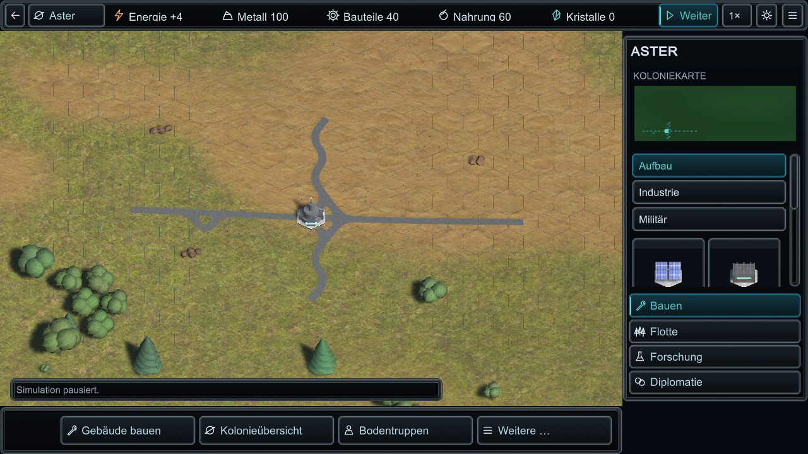 |
| Orbitale Brücke im System | 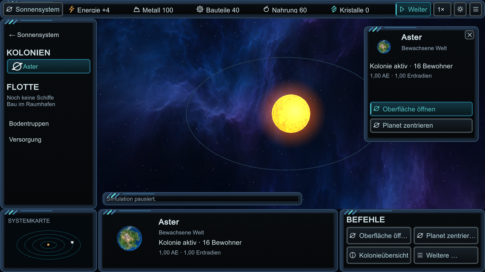 |
| Freier Weltraum mit 140-Prozent-Schrift | 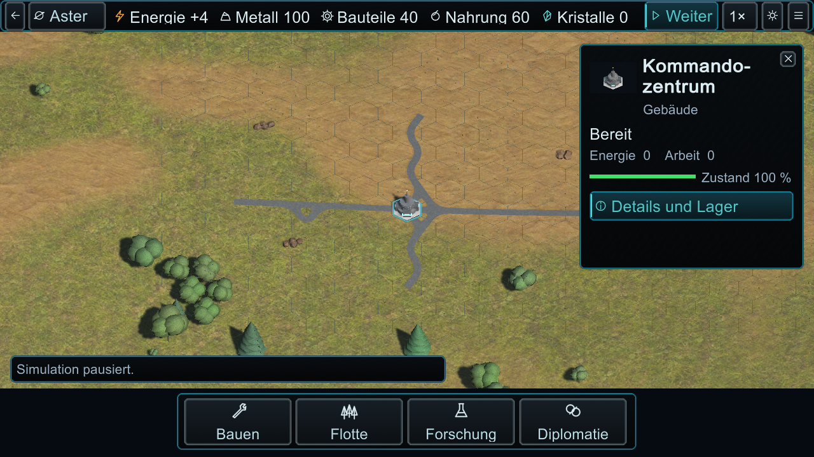 |
| Schrifteinstellung bei 1280×720 | 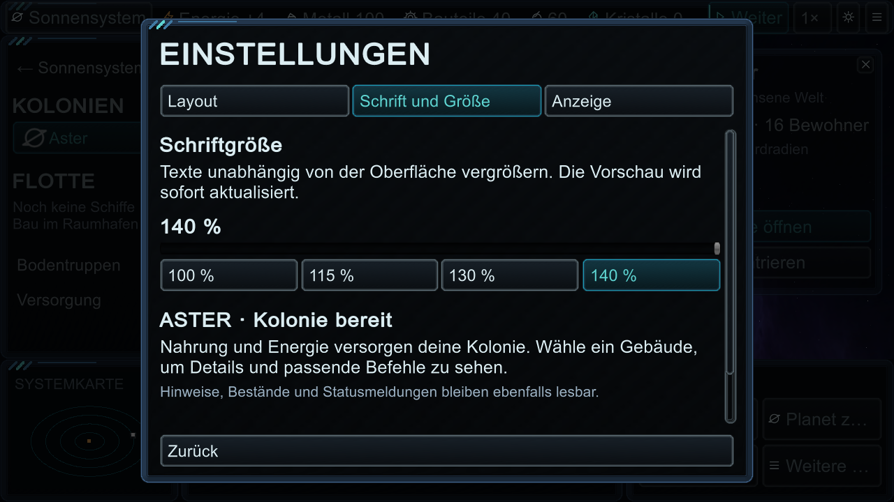 |
| Baustelle und tatsächlicher Baufortschritt | 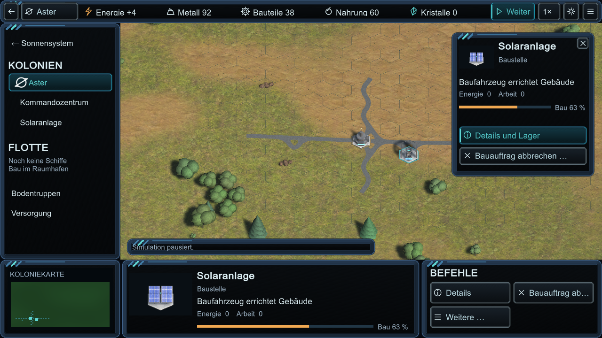 |
| Kampfvisualisierung | 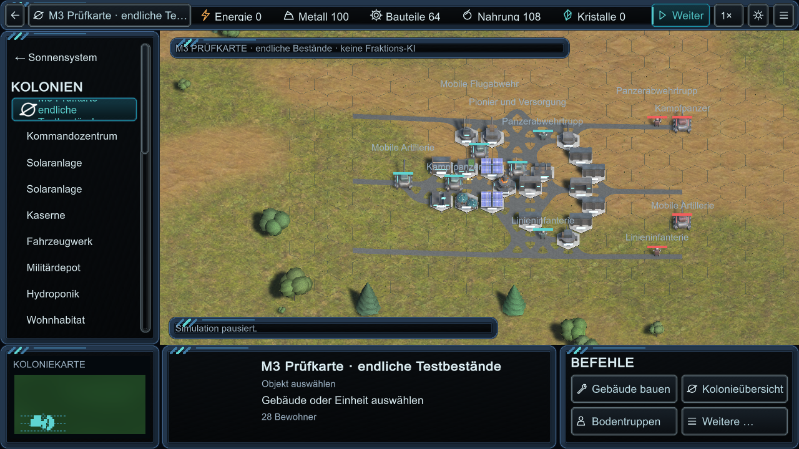 |
| Terrain und Bewuchs | 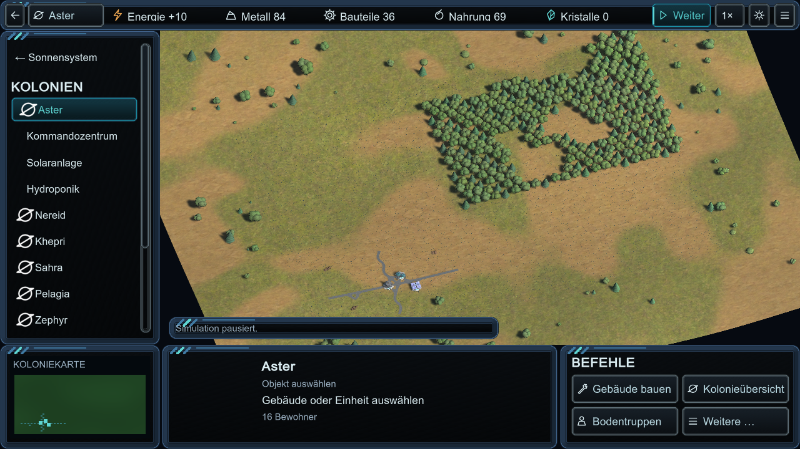 |
| Direkter Bodenangriff mit Auswahlrahmen und rotem Fadenkreuz | 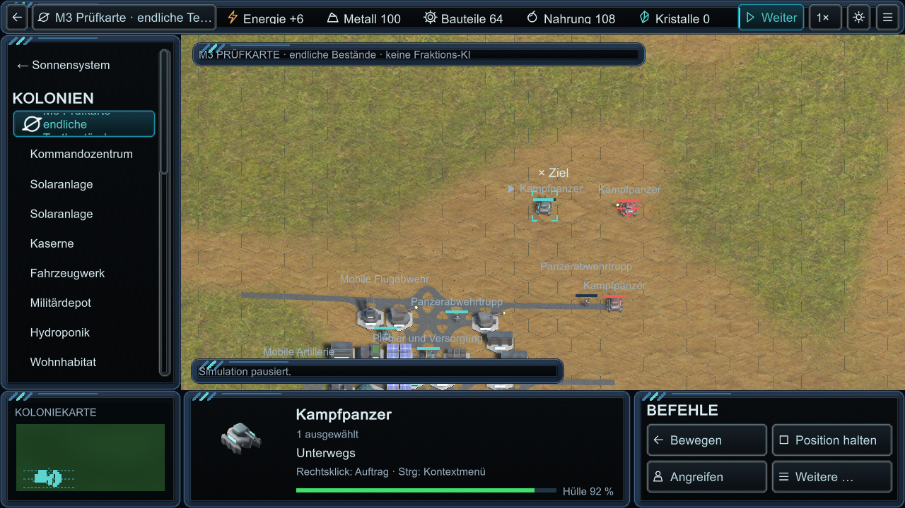 |
| Direkter Raumangriff | 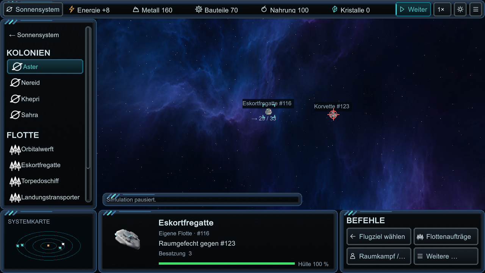 |
| Persistenter Planetenfokus | 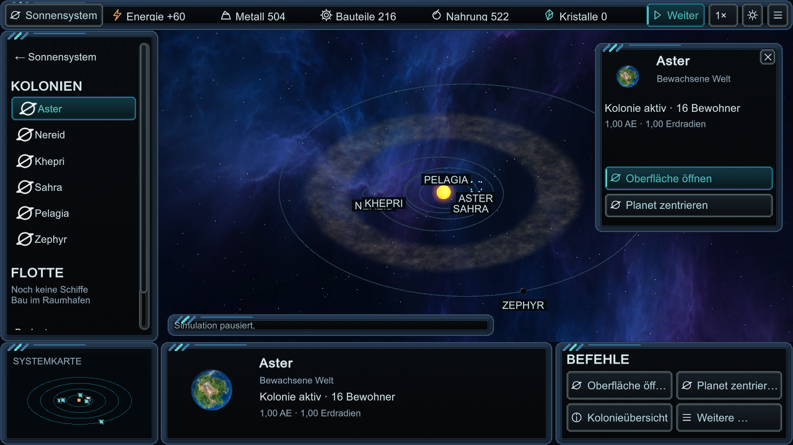 |
| Tatsächlicher Planetenshader mit der früheren Schnittkante zur Kamera |  |
| Grüner Bewegungsbogen über zweispuriger Straße | 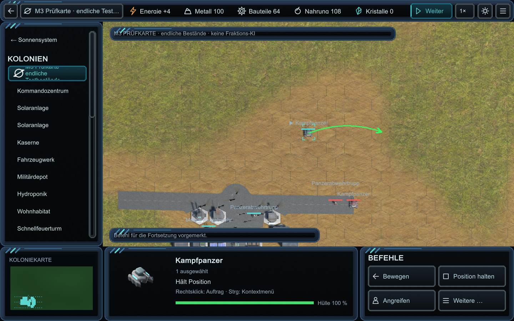 |
| Roter Angriffsbogen bis zum ersten tatsächlichen Schuss | 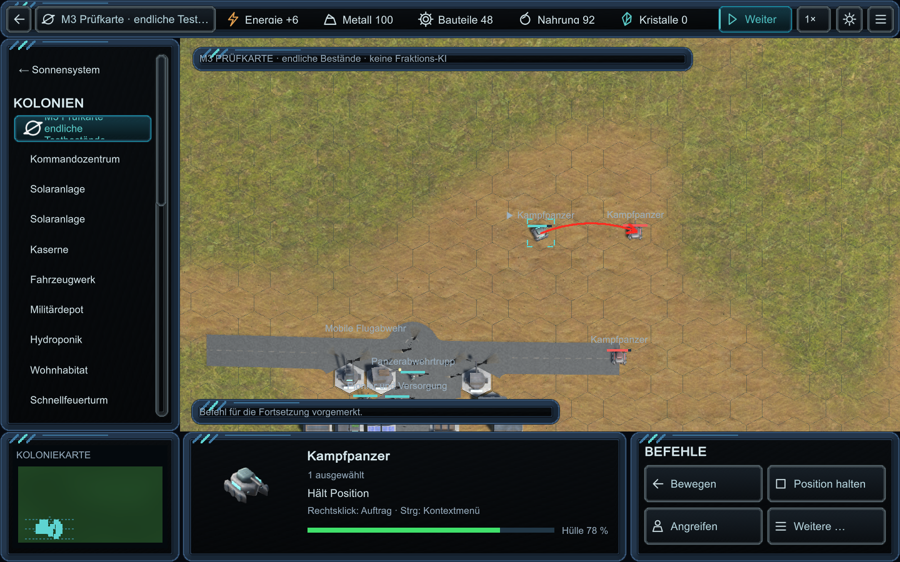 |

## Betroffene Implementierung

Runtime: `PrototypeTypography`, `PrototypePresentation`, `PrototypeHud`, `PrototypeSessions`, Befehls- und Verwaltungsmenüs, `PrototypeSmoothMotion`, `PrototypeRoadVisuals`, `PrototypeViewFlight`, `PrototypeColonyModels`, `PrototypeConstructionVisuals`, `PrototypeCombatVisuals`, neu `PrototypeDirectOrders`, `PrototypePlanetFocus`, `CelestialSurface` und die zugehörigen Darstellungsprüfungen. Core: `Definitions`, `SimulationState`, `SimulationEconomy`, `SimulationLogistics`, `SimulationGroundTraffic`, `SimulationSpaceTraffic`, `SaveCodec`/weitere Savevalidierung, gemeinsames Docking in KI, Besitzabwicklung und `CombatPresentationEvent`. Verhaltenstests: `ConstructionVehicleTests`, `CombatPresentationTests`, `GroundTrafficTests`, `SpaceTrafficTests` sowie der reguläre Referenzablauf in `ReferenceTests`/`ReferenceCombat`.

## Ergänzung vom 26. November: Zweispurige Straßen und Zielpfeile

LOG-015 / SURFACE-011 / GUI-022 / TEST-040 setzen die neuen Nutzeraufträge um. Straßen haben zwei echte Richtungsfahrspuren mit Rechtsverkehr und Mittellinie. Separate Ein- und Ausfahrten verhindern einen künstlichen Engpass am Depot. Kreuzende Fahrwege warten; Fahrzeuge auf derselben Route folgen mit realem Körperabstand. Baufahrzeuge bleiben während der Arbeit stehen und wechseln erst im Gebäudezugang auf die Rückspur. Eine freie Umfahrung geht dem Platzmachen stehender steuerbarer Einheiten vor, auch bei einem während der Fahrt aufgetauchten Hindernis. Panzer und andere Fahrzeuge besitzen eine 0,46-Einheiten-Hülle, sodass benachbarte Hexfelder tatsächlich belegbar sind.

Transparente Bögen kennzeichnen Mausbefehle: Grün für Fahrt, Rot für Angriff. Sie verschwinden nach tatsächlicher Ankunft bzw. dem ersten beobachteten Angriff auf das Ziel. Neue Befehle ersetzen alte Bögen; abgelehnte Befehle und verborgene Ziele liefern keine irreführenden Anzeigen.

Der isolierte Interaktionslauf `20261126-105431` bestand **194 Einzelbedingungen plus Gesamt-PASS**. Enthalten sind die echten grünen und roten GPU-Bilder sowie das Verschwinden nach Ankunft/Schuss. Der spätere 720p-Lauf `20261126-111230` bestand **488 Einzelbedingungen plus Gesamt-PASS** mit den inzwischen kleineren Fahrzeughüllen, allen drei Layouts, Bau-/Kampfphasen, Fokus und nahtfreien Planeten. Beide Läufe liefen ohne Aktivierung des Arbeitsdesktops; Bildschirmdateien wurden direkt betrachtet. Der abschließende Gesamtprüfstand wird unten nachgetragen.

Die Langzeitprüfung deckte außerdem eine übergroße diplomatische Mondsperrzone und fehlende KI-Frachterbeschaffung bei einer einzigen Kolonie auf. T-073 beschreibt die Korrekturen; T-074 die regulären Betriebsentscheidungen der aktualisierten F05-Spielersequenz. Es wurden dafür weder Waren geschenkt noch Gegner abgeschaltet oder Prüfziele entfernt.

## Aktueller Abschlussprüfstand vom 26. November 2026

- Vollständiger Core-/Plattformlauf: **212 Tests bestanden**, `TestResults/gui18-final-core.log` und `TestResults/Core/results.txt`.
- F05 mit Seed 8026: Solo-Sieg bei **Tick 110113**, tatsächlich produziert **1054 Metall / 250 Bauteile**. Enthalten: bezahlte KI-Invasion mit Landung, vorbereitete Eskorte im Raumkampf, Konvoiverlust, bezahlter Ersatz, erneute Kristallfracht und Toraktivierung. Koalition 1+3 gewinnt separat bei **Tick 69705** nach realen Lieferungen von **8 Metall / 2 Bauteilen**. Alle fünf Industriewarenbilanzen und exakte Speicherfortsetzungen stimmen.
- Anschließend erweiterter gezielter Satz: **45 Tests bestanden**, `TestResults/gui18-current-targeted.log`: 19 Bodenverkehr, 10 Bau, 13 Raumverkehr, 3 KI. Der Baufahrzeugtest enthält sowohl freie Umfahrung als auch eine künstliche enge Testpassage: Ohne Umfahrung wartet der Tank, das arbeitende Fahrzeug bewegt sich nicht und der Bau wird fertig.
- Aktueller Unity-Windows-Build erfolgreich: `TestResults/gui18-final-build.log`. Das Screenshotwerkzeug wartet auf einen geschlossenen PNG-Schreiber und vollständigen IEND-Abschluss. Die gewachsene vollständige Grafikprüfung darf insgesamt 360 Sekunden laufen; Simulations-, Render- und Speicherbudgets bleiben unverändert.
- Versionskonsistenz und Release-Werkzeuge bestanden; dabei wurde kein GitHub-Release veröffentlicht.

Die ältere Tabelle ist historische Evidenz. Der zuvor rote F05-Rennverlauf wurde durch reguläre Spielerbefehle gemäß T-074 behoben; keine Spielkosten, Gegner oder Abnahmekriterien wurden abgeschwächt. Ein vollständiger Playerlauf scheiterte zunächst am Lesen einer noch geschriebenen PNG, ein früherer an der Gesamtlaufzeitgrenze. Diese Versuche gelten nicht als bestandene Abnahme.

### Abschließender vollständiger Windows-Playerlauf

`TestResults/Presentation/20261126-114300`, **1440×900**, bestand **1053 Einzelbedingungen plus Gesamt-PASS** und erzeugte **187 PNGs**. Der Lauf enthält alle Menüs, drei Layouts, Schriftgrößen, Bau-/Kampfphasen, direkte Befehle, Zielpfeile, tatsächliche Modellhüllen, Planetenfokus und sechs nahtfreie GPU-Planetentexturen. Die beiden Zielpfeilbilder in dieser Dokumentation stammen aus diesem Lauf und wurden direkt visuell kontrolliert. Skript: `tools/Test-Presentation.ps1 -ReferenceSave TestResults/Reference/victory.json`.

| Aktuelle Messgröße | Ergebnis |
|---|---:|
| Simulation p95, Startzustand | 1,5495 ms |
| Simulation p95, Solo-Endzustand | 3,7928 ms |
| Renderzeit p95, System / Oberfläche | 16,7469 / 16,7192 ms |
| Prozess-Arbeitssatz | 418.914.304 Bytes, etwa 400 MiB |
| Endzustand | 5 Welten, 95 Gebäude, 14 Schiffe, 6 Truppen, 10 Kuriere, 2 KI |

Hardware wie oben: i7-13700, RTX 3060 Ti, Windows 11 / D3D11. Die T-052-Budgets sind erfüllt. Kein aktivierter Arbeitsdesktop, Computer-Use, Screenreader oder globale Eingabe. Die Bilder der langen Prüfkarte zeigen bei ihrem ungewöhnlich langen Namen einen abgeschnittenen Kolonielisten-Eintrag; daraus wird keine fehlerfreie Lesbarkeit beliebiger Textlängen oder pixelgenaue Übereinstimmung mit der Konzepttafel abgeleitet.
