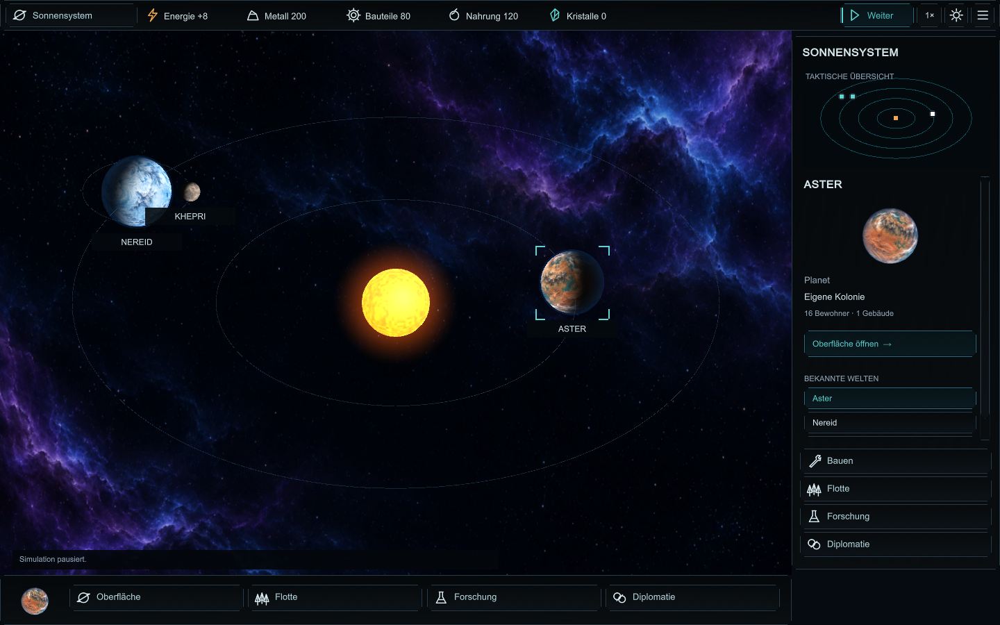
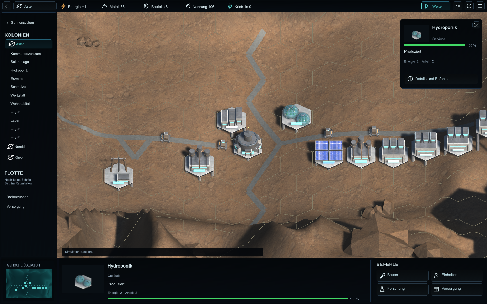
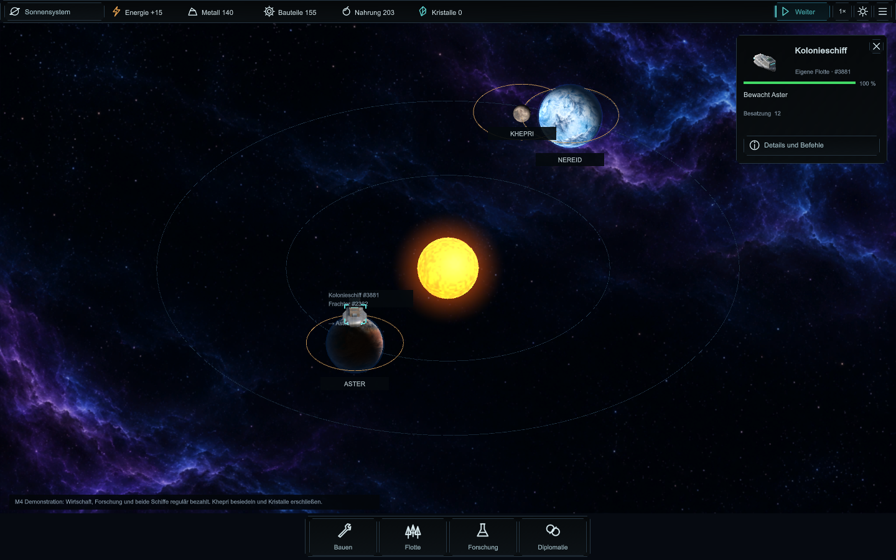

# GUI und Weltraumansicht – 1.0.11

Umsetzung des Nutzerauftrags D-030 vom 24. November 2026, aufbauend auf 1.0.10: GUI verständlicher gestalten und die Systemansicht an die vorhandene [Konzepttafel](GUI_REFERENCE.png) anpassen. Betroffen sind GUI-001 bis GUI-007, CORE-007/008 und TEST-026. Dies ist eine Präsentationslieferung auf M7; M8 bleibt separat.

## Gestaltung und Bedienung

Alle drei Layouts besitzen eine schmale Ressourcenleiste, eigene einheitliche Liniensymbole, dunkle Metallflächen, dünne cyanfarbene Akzente, Modellporträts und erklärende Tooltips. Aktive Auswahl und ausführbare Befehle bleiben erkennbar. Die Verwaltung wird aus einer Objektauswahl heraus geöffnet, statt die Spielfläche bei jeder Auswahl mit einem vollständigen Menü zu belegen.

| Layout | Aufteilung entsprechend der Vorlage |
|---|---|
| A · Kommandozentrale | Rechte feste Verwaltung mit Radar, Baukarten beziehungsweise Objektdetails und vier senkrechten Hauptbereichen; schmale Befehlsleiste unten |
| B · Orbitale Brücke | Kolonien, Gebäude und Flotte links; großes unteres Deck mit Radar, ausgewähltem Modell, Zustand und Befehlen; kompakte Auswahlkarte rechts |
| C · Freier Weltraum | Zentriertes schwebendes Dock mit vier Hauptbereichen; große freie Weltansicht und schließbare Auswahlkarte |

Ein **Planetenklick** wählt die Welt im System aus. **Oberfläche öffnen** oder ein **Doppelklick** öffnet die Kolonie. Oben führt der **Pfeil** zurück ins System; der **Koloniename** öffnet die Wirtschaftsübersicht mit Zugängen zu Bodentruppen und Versorgung. In B erlauben die Gebäudeeinträge links die direkte Auswahl und Kamerafokussierung. Ausführliche Gebäude-/Flottenfunktionen bleiben über **Details und Befehle** beziehungsweise **Flotte verwalten** erreichbar. Bauen, Forschung und Diplomatie besitzen in allen Layouts eigene Hauptschaltflächen; Versorgung ist auch im Frachtreiter der Flottenverwaltung erreichbar.

Die Auswahlkarte zeigt das tatsächlich ausgewählte Modell, Zustand und gegebenenfalls Hüllen-/Gebäude-/Einheitenzustand. **Bewegen** in den Befehlsleisten von A/B wartet auf ein Weltziel. Rechtsklickbefehle bleiben in allen Layouts verfügbar. Ein Klick auf ein GUI-Element darf weder einen Flug auslösen noch das wartende Ziel verbrauchen. **Esc** beendet zuerst einen aktiven Bau-/Zielmodus, schließt anschließend Verwaltung oder Auswahlkarte und öffnet danach das Spielmenü. Rechtsklick bricht einen über die Schaltfläche begonnenen Flugzielmodus ab.

Neue Partien, ausdrücklich gekennzeichnete Testszenarien, Speichern/Laden und die Rückkehr zur vorherigen Sitzung liegen im Spielmenü. Layout und Oberflächengröße bleiben unter **Einstellungen → Darstellung** gespeichert. Q/E, mittlere Maustaste und Pos1 behalten die räumliche Kamerasteuerung; die Systemkamera nutzt einen flacheren Anfangswinkel als das Gelände.

## Weltraum

Ein eigener detaillierter Atlas texturiert den ockerfarbenen Gesteinsplaneten, Eiswelten, Gasplaneten und Kratermonde. Es bleiben echte Kugelmodelle mit sonnenabhängiger Tag-/Nachtseite und axialer Drehung. Atmosphärenränder, eine warme Sonnenkorona, ein blau-violetter Nebel mit feinen Sternen und zurückhaltende Umlaufbahnen übernehmen die Bildsprache der Vorlage. Der Hintergrund folgt dem Kameraausschnitt und erhält keine Beleuchtung der Koloniewelt.

Planetennamen und Auswahlklammern beziehen sich auf bekannte reale Welten. Taktische Orbitalradien erscheinen bei Flottenauswahl oder in der Kriegsverwaltung. Schiffe bleiben vollständige 3D-Modelle. Ihre Darstellungsebene in Höhe 2,3 verhindert das Verschwinden in den größeren Planetenkörpern; Auswahl, Beschriftung und Flugzielprojektion verwenden dieselbe Höhe. Die simulierten Positionen, Reichweiten, Waren, Sichtregeln und Umlaufbahnen ändern sich nicht. Es werden keine zusätzlichen Planeten oder Gratisflotten für eine dekorative Bildkomposition angelegt.

Die beiden neuen Laufzeitgrafiken, ihre Speicherpfade und die vollständigen Imagegen-Prompts stehen in [ART_ASSETS](ART_ASSETS.md). GUI-Symbole und Metallrahmen sind im Projekt erzeugte Grafik; keine Dateien aus Command & Conquer, Haegemonia oder Solar 2 wurden übernommen.

## Tatsächliche Playerbilder

Die folgenden unveränderten Aufnahmen stammen aus dem finalen Windows-Player bei 1440 × 900, aufgenommen auf einem nicht eingeblendeten separaten Desktop. Sie sind vom generierten Entwurf zu unterscheiden.







## Reproduzierbare Prüfungen

```powershell
powershell -ExecutionPolicy Bypass -File tools/Test-Core.ps1
powershell -ExecutionPolicy Bypass -File tools/Unity.ps1 -Action Build
powershell -ExecutionPolicy Bypass -File tools/Test-Presentation.ps1
powershell -ExecutionPolicy Bypass -File tools/Test-Presentation.ps1 -Width 1280 -Height 720
powershell -ExecutionPolicy Bypass -File tools/Test-Prototype.ps1
powershell -ExecutionPolicy Bypass -File tools/Version.ps1 -Action Check
```

**126 Core-Tests**, Windows-Build mit Unity 6000.3.29f1 und Versionsprüfung für **1.0.11** bestanden. Der endgültige Player besteht **213 Einzelprüfungen je Lauf**; zusätzlich enthält das Protokoll eine PASS-Zeile für das Gesamtergebnis. Jeder Lauf erzeugt 62 PNGs einschließlich Gebäudekatalog.

| Lauf | Ausgabeordner |
|---|---|
| GUI 1440 × 900 | `TestResults/Presentation/20261124-171810` |
| GUI 1280 × 720 | `TestResults/Presentation/20261124-171927` |
| Fensterloser GPU-Batchtest | `TestResults/Smoke/20261124-172017` |

Neu geprüft: Planetenauswahl ohne Szenenwechsel, ausdrückliches Öffnen der ausgewählten Welt, unveränderter vollständiger Spielzustand beim Öffnen aller Verwaltungsbereiche, geschützte und wieder freigegebene Kartenflächen, kompakte Gebäudeauswahl, gesperrte Flugbefehle über Kopfzeile/Karten/Modalfenstern und ein tatsächlich in der gemeinsamen Simulation ausgeführter Bewegungsauftrag. Die bestehenden Wirtschafts-, Kampf-, KI-, Diplomatie-, Kamera- und Save/Load-Prüfungen bleiben enthalten.

Die echten GUI-Bilder für Systemansichten, Baukatalog, aufgebaute Kolonie, Flottenauswahl und Menü wurden visuell kontrolliert. Dabei korrigiert wurden zu dunkle Planetenvorschauen, in Planetenkörpern verdeckte Schiffe, überlappende Zustandszeilen im unteren Deck und fehlende direkte Zugänge zur Kolonieübersicht. Die finalen Playerlogs enthalten keine Exceptions, GUI-Fehler oder Shaderwarnungen.

`Test-Presentation.ps1` verwendet `CreateDesktop`/`CreateProcess`, ohne den Desktop umzuschalten oder globale Eingaben zu senden. Kein Screenreader, Computer-Use-Skill, sichtbarer Unity-Editor oder VM-Eingriff. Der Batchlauf rendert nur die Welt und ersetzt die GUI-Bildkontrolle nicht. Der Player liegt unter `Builds/Windows/PlanetOne.exe`; ein manueller Start wurde für diese Tests nicht ausgelöst.

## Grenzen und Integration

Die Aufteilung und die Bildsprache sind an die Vorlage angepasst; **eine pixelgleiche 1:1-Abnahme ist damit nicht erreicht**. Reale Planetenzahl und Positionen folgen dem Spielzustand, Modelldetail und Landschaft unterscheiden sich weiterhin von der Konzeptgrafik. Schiffe an derselben simulierten Position können sich überdecken; einzelne Schiffe sind zusätzlich über die Flottenliste auswählbar. Die automatisierten Controllerabläufe und kontrollierten Renderbilder ersetzen keinen vollständigen manuellen Maus-/Tastaturtest. Andere Plattformen, High-DPI-/Mehrmonitorbetrieb und das M8-Lastprofil bleiben ungeprüft.

Version 1.0.11 baut auf dem offenen Branch 1.0.10 auf. `main` stand bei Arbeitsbeginn auf M5; der PR gegen `main` enthält deshalb auch die vorhergehenden offenen Lieferungen #6 bis #10. Die bekannte fehlende Unity-Aktivierung in GitHub Actions wird nicht durch den lokalen Build ersetzt. Der aktuelle PR führt den Status des exakten gepushten Commits; ein fehlgeschlagener Pflichtcheck wird nicht umgangen. Lokaler Nachweis und Merge bleiben getrennte Ergebnisse.
