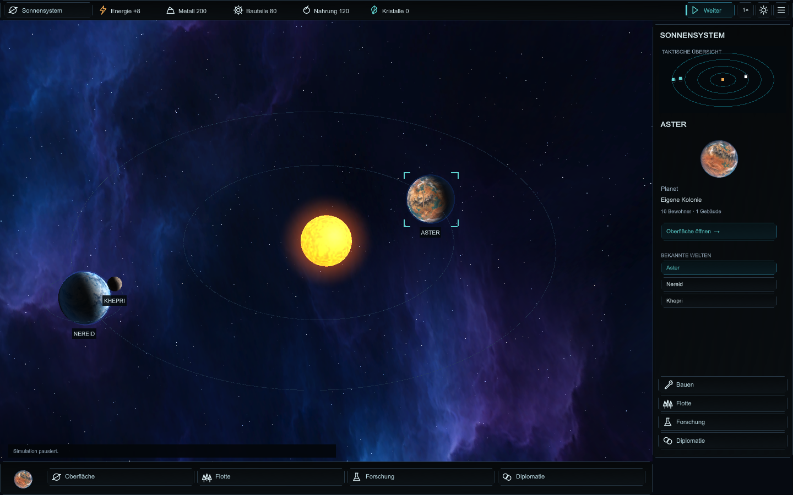
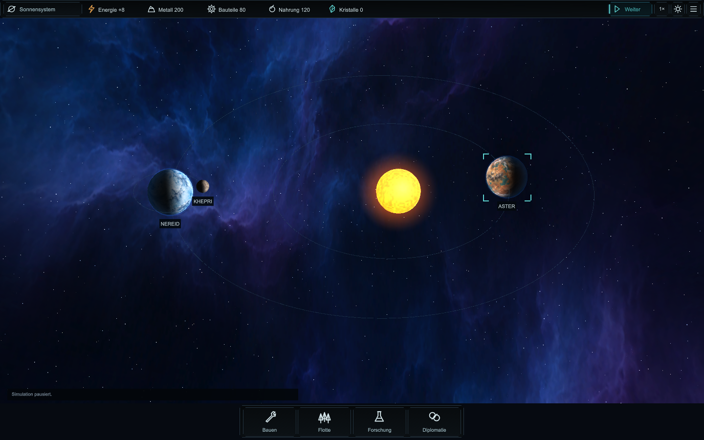

# Freie Systemkamera, Parallaxe und Keplerbahnen – 1.0.12

Nutzerauftrag D-031 vom 24. November 2026. Betroffene Regeln: GUI-003/008, SPACE-001 bis SPACE-003, CORE-007/008 und TEST-027. Die Lieferung baut auf 1.0.11 auf und verändert Kamera, räumlichen Hintergrund, Umlaufmodell und zwei GUI-Details. Sie schließt M8 nicht ab.

## Bedienung

| Eingabe | Verhalten in der Systemansicht |
|---|---|
| Rechte Maustaste halten und ziehen | Ansicht frei verschieben; der Stern darf außerhalb der Bildmitte liegen |
| Kurzer Rechtsklick | Befehl an ausgewählte Schiffe erst beim Loslassen; ein expliziter Flugzielmodus wird stattdessen abgebrochen |
| WASD / Pfeiltasten | Kamera in Blickrichtung verschieben |
| Q / E | Kamera drehen |
| Mittlere Maustaste ziehen | Kamera drehen und neigen |
| Mausrad | Bildausschnitt vergrößern oder verkleinern |
| Pos1 | Fokus wieder auf den Stern und Blickrichtung auf den Standard setzen |

Ab sechs Pixeln Bewegung gilt die rechte Geste als Ziehen. Auch mit ausgewählter Flotte löst sie keinen Flug aus. Eine Geste beginnt nur in der Welt, nicht auf einer Karte, Kopfzeile oder einem Menü. Öffnen eines Modalfensters und Ansichtswechsel beenden laufende Gesten. Der Fokus reicht bis ±250 Spieleinheiten pro Achse und bleibt beim Wechsel auf eine Oberfläche und zurück erhalten. Neue Sitzungen beziehungsweise Laden einer Sitzung beginnen wieder am Systemzentrum. Kamerafokus gehört nicht zum gespeicherten Simulationszustand.

Das dem Mauszeiger folgende Informationspopup wurde vollständig aus der Darstellung entfernt. Planetenbeschriftungen messen ihren Text in der tatsächlich verwendeten Schrift; die Hintergrundbreite entspricht dem Namen mit genau einem Leerzeichen davor und dahinter. Lange Namen bekommen keine pauschale Breite mehr.

## Tiefengestaffelter Hintergrund

12.000 Sterne besitzen feste räumliche Positionen in unterschiedlichen Entfernungen zwischen 900 und 18.000 Spieleinheiten. Sie werden in einem gemeinsamen Mesh über eine perspektivische Hintergrundkamera gerendert. Beim Verschieben entsteht dadurch tatsächliche perspektivische Parallaxe: näher gelegene Sterne verändern ihre Bildschirmposition stärker als weit entfernte. Die großen Entfernungen halten diese Bewegung deutlich kleiner als die der Spielwelt.

Die sternfreie Nebeltextur liegt auf einer ortsfesten umgebenden Kugel mit Radius 22.000. Sie bewegt sich bei Kameratranslation deshalb noch weniger, reagiert aber auf die vollständige Blickrotation. Anders als zuvor wird kein flaches Bild an die Kamera angeheftet. Die Kameras verwenden dieselbe Position, Blickrichtung und denselben Welt-Viewport; der Hintergrund läuft vor der orthografischen Spielwelt. Derselbe Ablauf wird im fensterlosen RenderTexture-Test verwendet. Die Hintergrundsterne sind reine Darstellung, keine zusätzlichen Ressourcen oder anfliegbaren Spielwelten.

`StarlessNebula.png` wurde eigens als diffuse Gas-/Staubtextur ohne eingebackene Sterne erstellt. Speicherpfad, Herkunft und vollständiger Prompt stehen in [ART_ASSETS](ART_ASSETS.md). Die ältere sternhaltige Grafik bleibt als historisches Asset erhalten und ist nicht mehr an das aktuelle Hintergrundmaterial gebunden.

## Bahnen und Eigenrotation

Die gemeinsame Simulation löst `M = E − e·sin(E)` und berechnet die Position als `x = a·(cos(E) − e)`, `y = a·√(1−e²)·sin(E)`, anschließend gedreht um die Periapsisrichtung. Dadurch liegt der Bezugskörper in einem Brennpunkt, die Flächengeschwindigkeit bleibt konstant und die Bewegung ist nahe am Bezugskörper schneller. Die Perioden folgen für denselben Bezugskörper `T ∝ a^(3/2)`. Grundlage: [NASA – Keplers Gesetze](https://science.nasa.gov/solar-system/orbits-and-keplers-laws/) und [JPL – Keplergleichung und Bahnkoordinaten](https://ssd.jpl.nasa.gov/planets/approx_pos.html), geprüft am 24. November 2026.

| Welt | Große Halbachse | Exzentrizität bei neuem Spiel | Neue Umlaufzeit bei 1× |
|---|---:|---:|---:|
| Aster | 10 | 0,06 | 2 Stunden |
| Nereid | 18 | 0,09 | ca. 4 Stunden 50 Minuten |
| Helios, diplomatische Partie | 25 | 0,12 | ca. 7 Stunden 54 Minuten |
| Khepri, relativ zu Nereid | 3 | 0,04 | 6 Stunden |

Zuvor betrugen die Sternumlaufzeiten 240, 420 beziehungsweise 540 Sekunden; Khepri umlief seinen Planeten in 60 Sekunden. Die neuen Werte sind bewusst wesentlich ruhiger. Die Eigenrotation benötigt `9000 + Welt-ID × 1200` Sekunden pro Umdrehung, beispielsweise 2 Stunden 50 Minuten für Aster. Sie dreht um die geneigte eigene Achse und verwendet ebenfalls die Simulationszeit. Pause hält Umlauf und Eigenrotation an; höheres Spieltempo beschleunigt sie gemeinsam.

Es handelt sich um ein **skaliertes Kepler-Zweikörpermodell** mit hierarchischen Mondbahnen. Zeiten, Entfernungen und sichtbare Körpergrößen sind für das Spiel gewählt. Gegenseitige gravitative Störungen, ein baryzentrisches Mehrkörpersystem, langfristige Bahnstabilität und realmaßstäbliche Astronomie werden nicht simuliert. Schiffe behalten ihre steuerbaren Flugaufträge; diese verwenden weiterhin dieselben autoritativen Weltpositionen wie KI, Sensoren, Versorgung und Eroberung. Die angezeigten Orbitlinien werden aus demselben Bahnrechner erzeugt.

## Spielstände

Schema 9 ergänzt `OrbitEccentricity` und `OrbitPeriapsis`. Alte V1–V8-Spielstände durchlaufen ihre bisherigen Migrationen und anschließend die Bahnumstellung. Vorhandene Kreise werden als Kepler-Sonderfall `e=0` übernommen. Die neue Phase gleicht die längere Periode an der gespeicherten Simulationszeit aus: kein Positionssprung beim Laden, keine versetzten Schiffe und keine Änderung von Waren, Eigentum oder laufenden Aufträgen. Neue Partien verwenden die oben angegebenen Ellipsen.

`Tests/Core/Fixtures/prototype-v8.json` stammt aus dem echten isolierten 1.0.11-Testlauf `TestResults/Smoke/20261124-172017/smoke-save.json`. Der Migrationstest prüft die alten Kreispositionen unabhängig, vergleicht alle nichtorbitalen Werte vollständig und setzt einen neu gespeicherten Stand deterministisch fort. Die vorhandene reale V5-Prüfkarte bleibt ebenfalls erhalten; ihr Bestandsvergleich nimmt nur die bewusst geänderten Bahnparameter aus.

## Nachweise

```powershell
powershell -ExecutionPolicy Bypass -File tools/Test-Core.ps1
powershell -ExecutionPolicy Bypass -File tools/Unity.ps1 -Action Build
powershell -ExecutionPolicy Bypass -File tools/Test-Presentation.ps1
powershell -ExecutionPolicy Bypass -File tools/Test-Presentation.ps1 -Width 1280 -Height 720
powershell -ExecutionPolicy Bypass -File tools/Test-Prototype.ps1
powershell -ExecutionPolicy Bypass -File tools/Version.ps1 -Action Check
```

**132 Core-Tests**, Unity-6000.3.29f1-Windows-Build und Versionsprüfung für **1.0.12** bestanden. Sechs neue Core-Prüfungen weisen Ellipsenbrennpunkt/Periodenschluss, gleiche Flächen pro Zeit, Geschwindigkeitsunterschied, Periodenrelation, Pause/Save-Fortsetzung, echte V8-Migration und Ablehnung ungültiger Parameter nach. Alle bisherigen Wirtschafts-, Kampf-, KI-, Diplomatie- und Bestandsprüfungen bleiben grün.

Der Player besteht **239 Einzelprüfungen je Lauf**; das Protokoll enthält zusätzlich eine PASS-Zeile für das Gesamtergebnis. Je Lauf entstehen **66 PNGs**.

| Lauf | Ausgabeordner |
|---|---|
| Vollständige GUI, 1440 × 900 | `TestResults/Presentation/20261124-224010` |
| Vollständige GUI, 1280 × 720 | `TestResults/Presentation/20261124-224049` |
| Fensterloser GPU-Test | `TestResults/Smoke/20261124-224251` |

Die Kameraprüfung vergleicht echte Projektionen sichtbarer Sterne: mehr als vierfach unterschiedliche Tiefe, mehr als dreifacher Unterschied in der Verschiebung, dabei weniger als ein Zehntel der Weltverschiebung für den geprüften nahen Stern. Drehung verändert die Hintergrundprojektion. Rechtsziehen verschiebt in allen Layouts den Stern aus der Bildmitte; Zurücksetzen funktioniert. Ziehen mit ausgewähltem Schiff erzeugt keinen Auftrag; kurzer Rechtsklick und Abbruch des Zielmodus werden getrennt geprüft. Reine Kameragesten erhalten den vollständigen Spielstand. Die Eigenrotation bleibt in Pause unverändert und beträgt über 30 Simulationssekunden weniger als zwei Grad.

Echte Playerbilder zeigen den drehenden Hintergrund, die verschobene Systemansicht und knappen Namensschilder. Keine Exceptions, GUI-Fehler oder Shaderwarnungen in den finalen Logs. Der reguläre GUI-Player läuft auf einem separaten, nicht eingeblendeten Windows-Desktop ohne globale Eingaben; der zusätzliche GPU-Lauf ist fensterlos. Kein Screenreader, Computer-Use oder Eingriff in vorhandene VMs. Ein vollständiger manueller Klicktest und die M8-Plattform-/Lastprüfung werden daraus nicht abgeleitet.





## Git-Integration

Version 1.0.12 baut auf dem offenen 1.0.11-Branch auf; der PR gegen `main` enthält weiterhin die vorherigen offenen Lieferungen #6 bis #11. Der lokale Player liegt unter `Builds/Windows/PlanetOne.exe`. GitHub prüft den exakten veröffentlichten Commit separat. Die bislang fehlenden Unity-Aktivierungs-Secrets können den Pflichtcheck weiterhin blockieren; kein Admin-Bypass und kein behaupteter Merge trotz fehlgeschlagener Prüfung. Der aktuelle PR weist dessen konkreten CI-Status aus.
