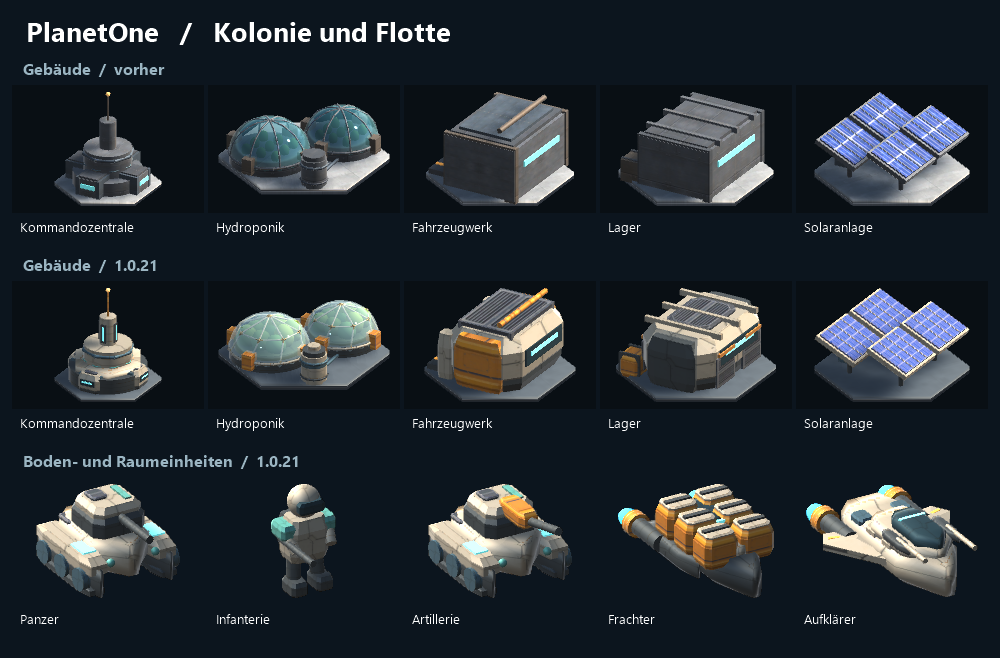

# Kolonie- und Flottenmodelle in 1.0.21

Die [Kolonietafel](ColonyModelReference.png) bestimmt Material und Aufbau der Gebäude. Aus der [Raumfahrttafel](SpaceModelReference.png) stammen die gepfeilte Silhouette des Aufklärers und die offenen Containerreihen des Frachters. Die folgenden Aufnahmen zeigen tatsächliche Bau- und Produktionsporträts aus dem Windows-Player. Beide Gebäudereihen verwenden dieselbe Katalogperspektive.

## Modelle im Spiel

- Gebäudeverkleidungen haben abgeschrägte Kanten und eingelassene Fenster. Das Fahrzeugwerk hat ein oranges Montageportal. Das Lager hat dunkle Rolltore und Lademarkierungen. Zwischen den Streben der gläsernen Farmkuppeln sind die Pflanzungen zu sehen.
- Bodentruppen tragen Helm, Visier und Schulterpanzer. Am Panzer unterscheiden sich Kettenlaufwerk, Schürzen und drehbarer Turm. Artillerie hat eine verlängerte Rohrwiege und Flak ein Suchradar. Transport- und Baufahrzeuge sind an Ladebehälter und Kranarm erkennbar.
- Aufklärer haben gepfeilte Flügel, Frachter seitlich sichtbare Frachtmodule und das Vermessungsschiff eine geneigte Messschüssel. Antrieb, Cockpit und Wartungsflächen gliedern die Schiffsrümpfe.
- Der Katalog rendert die Spielmodelle aus seiner eigenen Kameraperspektive. Ein gerichtetes Aufhelllicht auf der Porträtebene macht die Schattenseiten kleiner Bauteile lesbar. Der neue Atlas enthält Lackplatten, Lüftungsgitter, Frachtverkleidungen und Solarzellen. Die Projektion folgt den Modellachsen, auch wenn ein Fahrzeug oder Turm dreht.

## Prüfablauf

Am 28. November 2026 bestanden alle 227 Core-Tests und 1.141 einzelne Bedingungen im Windows-Player. Der isolierte Lauf erzeugte 224 Bilder, darunter die 40 Katalogporträts. Bei 1440 × 900 auf einer GeForce RTX 3060 Ti lag das 95. Perzentil der Bildzeit in Sonnensystem und Oberfläche bei jeweils 16,7 ms über 360 Bilder pro Ansicht.

Im Projektverzeichnis führt `tools/Test-Core.ps1` die Simulationstests aus. `tools/Unity.ps1 -Action Build` erstellt den Windows-Player. Anschließend prüft `tools/Test-Presentation.ps1 -ReferenceSave TestResults/Reference/victory.json` die Darstellung auf einem isolierten Desktop. Die Referenzdatei stammt aus dem Core-Prüflauf. Der Katalogexport schreibt alle 25 Gebäude-, sechs Bodeneinheiten- und neun Schiffsporträts in das Ergebnisverzeichnis des Durchlaufs.

## Herkunft der Texturen

Der [Modellatlas](../Assets/PlanetOne/Runtime/Resources/ModelFinishAtlas.png) wurde für PlanetOne mit ImageGen erzeugt. Die Modelle sind dreidimensionale Unity-Meshes. Die PNG-Vergleichstafel verwendet ausschließlich gerenderte Modelle aus dem Spiel.

Generierungsprompt des Texturatlas

~~~text
Create a SQUARE game-ready industrial PBR base-color texture atlas for PlanetOne. EXACT 2 by 2 equal square tiles edge to edge with boundaries at 50% width and height. Orthographic front-on flat surface scans, no perspective, no arrangement of objects, no border, no gutters, no text, labels, symbols, screws spelling words or logo. Upper left: warm ivory aerospace ceramic armour, four broad irregular inset maintenance plates with chamfered panel corners, black gasket seams, restrained tiny recessed bolts, subtle edge wear; paint is light, matte. Upper right: graphite blue-black machinery panel, broad parallel recessed dark cooling louvers in two groups with steel frames. Lower left: ochre orange industrial cargo casing, two broad raised golden orange ribs, recessed access plate, modest worn paint at rim and a single narrow dark safety stripe. Lower right: saturated deep cobalt blue photovoltaic cells with fine silver busbars and faint crystalline surface. Confident clean hard-surface detail readable in tiny RTS building portraits; neutral evenly lit diffuse albedo, no cast shadows and no baked specular. Flat tileable edges per quadrant. Fill the image with these four materials.
~~~

